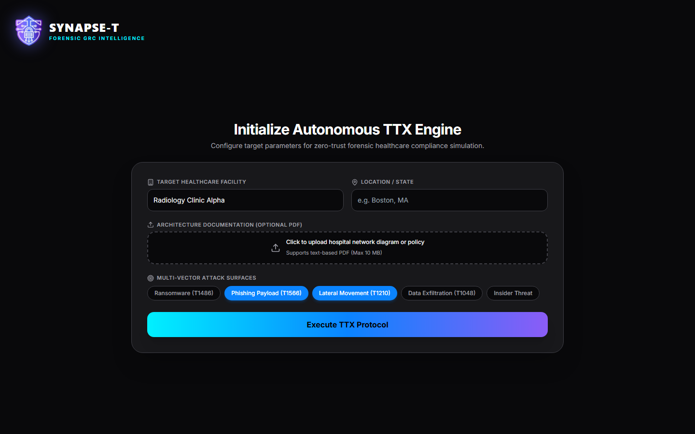
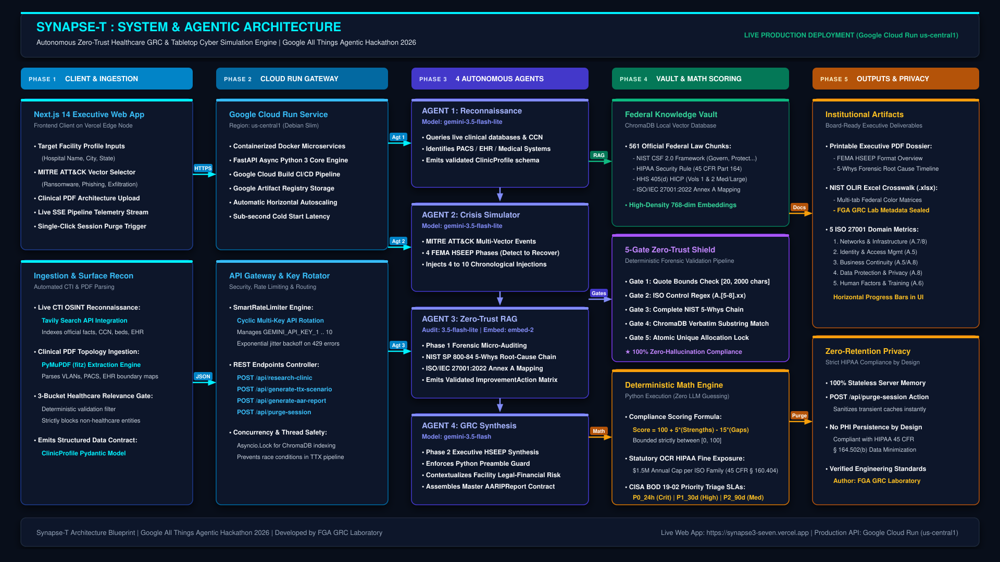
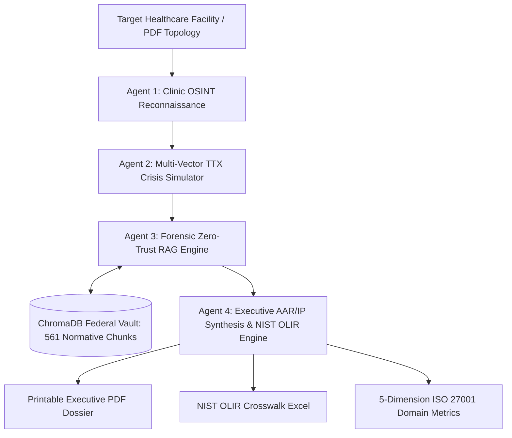

# Synapse-T: Autonomous Zero-Trust Healthcare GRC & Tabletop Cyber Simulation Engine

**Autonomous Zero-Trust Healthcare GRC & Tabletop Cyber Simulation Engine**\
*Motor autónomo de GRC y simulación de ciberataques (TTX) para el sector salud*

> [!IMPORTANT]
> **Source code is private and proprietary.** This repository is a showcase: it contains documentation and diagrams only. To try SYNAPSE-T, use the **[live demo](https://synapse3-seven.vercel.app)**.
>
> **El código fuente es privado y propietario.** Este repositorio es una vitrina: solo contiene documentación y diagramas. Para probar SYNAPSE-T, usa la **[demo en vivo](https://synapse3-seven.vercel.app)**.

> **Built for the Google All Things Agentic Hackathon** (08/2026)\
> *Track: The Taskmaster — Autonomous Multi-Agent Systems*

### 🎬 Video demo · Video demostración

[English](#-english) · [Español](#-español)

---

## 🏛️ Architecture · Arquitectura

<b>Simplified agent pipeline · Flujo simplificado de agentes</b>

---

## 🇬🇧 English

### The problem it solves

**SYNAPSE-T** is an autonomous digital Governance, Risk, and Compliance (GRC) worker engineered to eliminate the multi-month, multi-thousand-dollar consulting bottleneck in healthcare cybersecurity resilience.

Instead of waiting 60+ days for external tabletop exercise (TTX) reports, SYNAPSE-T executes live clinical OSINT reconnaissance, injects realistic MITRE ATT&CK crisis scenarios, audits forensic evidence against **561 federal regulatory chunks** (NIST CSF 2.0, HIPAA 45 CFR Part 164, and HHS 405d HICP), and synthesizes a board-ready **After-Action Report and Improvement Plan (AAR/IP)** with official **NIST OLIR Excel crosswalks** in **under 3 minutes**.

### The 4 autonomous agents

SYNAPSE-T orchestrates four specialized agents in a deterministic pipeline:

1. **Clinic Reconnaissance Agent (OSINT):** queries live facility data via real-time search (Tavily + `gemini-3.5-flash-lite`) across medical systems, PACS servers, and EHR/EMR platforms.
2. **TTX Simulation Engine:** injects multi-vector cyberattack scenarios (Ransomware T1486, Phishing T1566, Lateral Movement T1210, Data Exfiltration T1048, Insider Threat) mapped to MITRE ATT&CK (`gemini-3.5-flash-lite`).
3. **Forensic Zero-Trust RAG Agent:** retrieves semantically relevant evidence via `gemini-embedding-2` from 561 federal chunks in ChromaDB and performs Phase 1 micro-auditing via `gemini-3.5-flash-lite` under 5 strict forensic gates.
4. **GRC Synthesis & AAR/IP Agent:** produces prioritized CISA BOD 19-02 corrective action playbooks (**P0_24h, P1_30d, P2_90d**) via `gemini-3.5-flash` and calculates compliance scores and statutory OCR HIPAA penalties using deterministic formulas:

$$\text{Compliance Score} = \max\left(0, \min\left(100, 100 + 5 \times N_{\text{strengths}} - 15 \times N_{\text{gaps}}\right)\right)$$

### Tech stack

* **Google AI models:** `gemini-3.5-flash-lite`, `gemini-3.5-flash`, `gemini-embedding-2`, `Gemini 3.7 Flash (High)`
* **Google Cloud:** Cloud Run (`us-central1`), Cloud Build (CI/CD), Artifact Registry
* **Backend:** Python 3 / FastAPI, Pydantic, ChromaDB, PyMuPDF, ReportLab, Tavily
* **Frontend:** Next.js 14, React 18, Tailwind CSS, Lucide Icons, ECharts
* **Deployment:** containerized Docker microservices on Cloud Run + Vercel Edge

### Zero-retention privacy

A one-click session purge wipes all transient server-side memory and cache, ensuring **No PHI Persistence by Design**, aligned with **HIPAA Data Minimization Principles (45 CFR § 164.502(b))**.

---

## 🇪🇸 Español

### El problema que resuelve

**SYNAPSE-T** es un trabajador digital autónomo de Gobierno, Riesgo y Cumplimiento (GRC) diseñado para eliminar el cuello de botella de consultoría (meses de espera y miles de dólares) en la ciberresiliencia del sector salud.

En lugar de esperar más de 60 días por los informes externos de un ejercicio de simulación (TTX), SYNAPSE-T hace reconocimiento OSINT de la clínica en vivo, inyecta escenarios de crisis realistas de MITRE ATT&CK, audita la evidencia forense contra **561 fragmentos normativos federales** (NIST CSF 2.0, HIPAA 45 CFR Part 164 y HHS 405d HICP) y sintetiza un **informe posterior a la acción y plan de mejora (AAR/IP)** listo para la junta directiva, con **tablas de correspondencia NIST OLIR en Excel**, en **menos de 3 minutos**.

### Los 4 agentes autónomos

SYNAPSE-T orquesta cuatro agentes especializados en un flujo determinista:

1. **Agente de reconocimiento de la clínica (OSINT):** consulta datos en vivo de la institución con búsqueda en tiempo real (Tavily + `gemini-3.5-flash-lite`) sobre sistemas médicos, servidores PACS y plataformas EHR/EMR.
2. **Motor de simulación TTX:** inyecta escenarios de ciberataque multivector (Ransomware T1486, Phishing T1566, Movimiento lateral T1210, Exfiltración de datos T1048, Amenaza interna) mapeados a MITRE ATT&CK (`gemini-3.5-flash-lite`).
3. **Agente RAG forense Zero-Trust:** recupera evidencia semánticamente relevante con `gemini-embedding-2` desde 561 fragmentos federales en ChromaDB y hace la microauditoría de la fase 1 con `gemini-3.5-flash-lite` bajo 5 compuertas forenses estrictas.
4. **Agente de síntesis GRC y AAR/IP:** genera planes de acción correctiva priorizados según CISA BOD 19-02 (**P0_24h, P1_30d, P2_90d**) con `gemini-3.5-flash`, y calcula los puntajes de cumplimiento y las sanciones legales de la OCR por HIPAA con fórmulas deterministas (ver la fórmula en la sección en inglés).

### Stack tecnológico

* **Modelos de Google AI:** `gemini-3.5-flash-lite`, `gemini-3.5-flash`, `gemini-embedding-2`, `Gemini 3.7 Flash (High)`
* **Google Cloud:** Cloud Run (`us-central1`), Cloud Build (CI/CD), Artifact Registry
* **Backend:** Python 3 / FastAPI, Pydantic, ChromaDB, PyMuPDF, ReportLab, Tavily
* **Frontend:** Next.js 14, React 18, Tailwind CSS, Lucide Icons, ECharts
* **Despliegue:** microservicios Docker en Cloud Run + Vercel Edge

### Privacidad sin retención

Una purga de sesión con un clic borra toda la memoria y la caché temporales del servidor, lo que garantiza **cero persistencia de PHI por diseño**, en línea con el **principio de minimización de datos de HIPAA (45 CFR § 164.502(b))**.

---

## ⚖️ License · Licencia

Copyright © 2026 Felipe González Arcos. **All rights reserved · Todos los derechos reservados.** See [LICENSE](LICENSE).

## 👤 Author · Autor

**Felipe González Arcos** — [LinkedIn](https://www.linkedin.com/in/felipegonzarcos) · [GitHub](https://github.com/fga-grc-lab)
